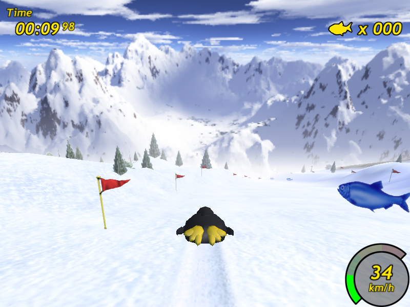
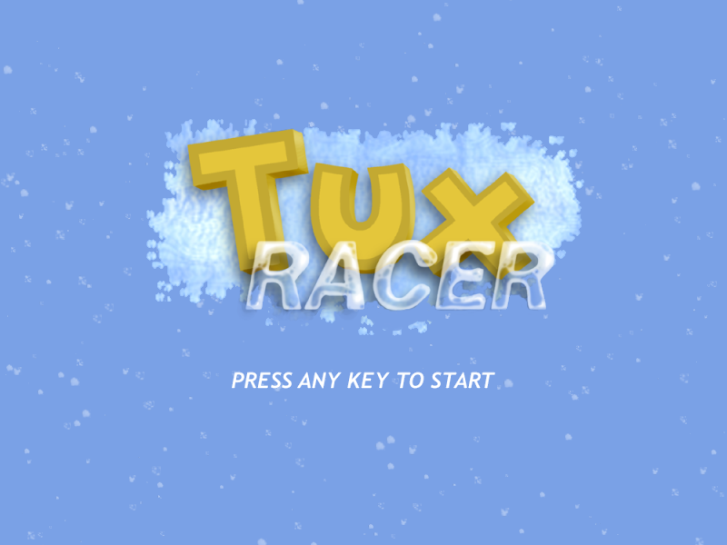
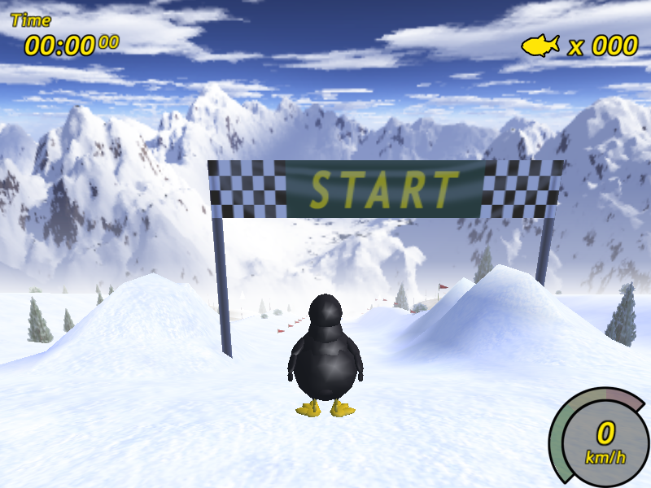

# Tux Racer 0.61 — SDL2

**Tux Racer 0.61 (2001) recompilé pour aujourd'hui : macOS (Apple Silicon et Intel),
Windows 10/11 x64 et Linux x86-64.**
*Tux Racer 0.61 rebuilt for today's macOS, Windows and Linux (SDL2 port).*



Tux Racer est un jeu libre créé par Jasmin F. Patry et Sunspire Studios :
Tux, la mascotte de Linux, dévale des pistes enneigées en ramassant des harengs.
Les binaires de l'époque ne sont plus téléchargeables et ne tournent plus sur
les systèmes actuels. Ce dépôt reprend la version 0.61 d'origine et la porte
sur SDL2, sans rien changer au jeu.

Portage non officiel. « Tux Racer » est une marque de Jasmin F. Patry.

## Télécharger

Dans les [Releases](https://github.com/labbej27/tuxracer/releases) :

| Système | Fichier |
|---|---|
| macOS 11+ (universel arm64 + x86_64) | `TuxRacer-0.61-sdl2-macOS.zip` |
| Windows 10/11 x64 | `TuxRacer-0.61-sdl2-Windows-x64.zip` |
| Linux x86-64 (glibc 2.35+, libGLU) | `TuxRacer-0.61-sdl2-Linux-x86_64.tar.gz` |

Les applications ne sont pas signées : sur Mac, clic droit > Ouvrir au premier
lancement ; sur Windows, « Informations complémentaires » > « Exécuter quand
même ». Sous Linux, `libglu1-mesa` si `libGLU.so.1` manque.

| | |
|---|---|
|  |  |
|  |  |

## Commandes

Gauche/Droite tourner, Haut pagayer, Bas ou Espace freiner, E sauter
(maintenir pour charger), D + direction en l'air pour les figures, P pause,
Q ou Échap quitter, Retour arrière replacer Tux, 1 2 3 caméras,
Alt+Entrée plein écran / fenêtre.

## Crédits

Jeu : Jasmin F. Patry, Patrick Gilhuly, Eric Hall, Rick Knowles, Vincent Ma,
Mark Riddell (Sunspire Studios) et les contributeurs listés dans
[AUTHORS](AUTHORS). Musique : Joseph Toscano. Licence : GNU GPL v2
([COPYING](COPYING)).

## Ce qui a changé

Le premier commit contient le source et les données d'origine
(https://tuxracer.sourceforge.net/). Les commits suivants regroupent le portage.

- SDL 1.2 → SDL2 / SDL2_mixer (fenêtre, contexte OpenGL, clavier, joystick,
  musique .it via libxmp), Alt+Entrée bascule le plein écran.
- Données cherchées à côté de l'exécutable (`data/`, ou
  `Contents/Resources/data` dans le bundle macOS) ; options dans
  `~/.tuxracer` (macOS/Linux) ou `%APPDATA%\TuxRacer` (Windows).
- Corrections : collage de jetons du préprocesseur refusé par les compilateurs
  actuels, tampon trop petit pour un pointeur 64 bits (plantage), sauvegardes et
  captures ouvertes en mode texte (corrompues sous Windows).
- Build CMake ; SDL2, SDL2_mixer et Tcl 8.6 liés en statique.

## Compiler
Sources des dépendances attendues dans `deps/` (SDL2 2.32.10,
SDL2_mixer 2.8.1 avec `external/libxmp` branche `4.6.1-SDL`, Tcl 8.6.16).
Les sorties vont dans `$TR_BUILD_ROOT` (par défaut `out/`) ; à garder hors
d'un dossier synchronisé par iCloud.

```sh
export TR_BUILD_ROOT=~/Library/Caches/tuxracer
# macOS
scripts/build-deps.sh macos
cmake -S . -B $TR_BUILD_ROOT/build-macos -DCMAKE_BUILD_TYPE=Release \
  -DCMAKE_PREFIX_PATH=$TR_BUILD_ROOT/deps-prefix/macos -DTCL_PREFIX=$TR_BUILD_ROOT/deps-prefix/macos \
  "-DCMAKE_OSX_ARCHITECTURES=arm64;x86_64" -DCMAKE_OSX_DEPLOYMENT_TARGET=11.0
cmake --build $TR_BUILD_ROOT/build-macos
# Linux et Windows (conteneur Ubuntu 22.04 amd64, MinGW-w64)
docker build -t tuxracer-build docker
for P in linux windows; do
  docker run --rm --platform linux/amd64 -v "$PWD":/w -v $TR_BUILD_ROOT:/out \
    -e TR_BUILD_ROOT=/out -w /w tuxracer-build \
    sh -c "scripts/build-deps.sh $P && scripts/build-in-docker.sh $P"
done
```

`-DTR_AUTOTEST=ON` produit une version de test qui appuie seule sur Entrée et
enregistre des captures (`TR_AUTOKEY=9 TR_SHOTDIR=...`), utile sous Xvfb/Wine.
